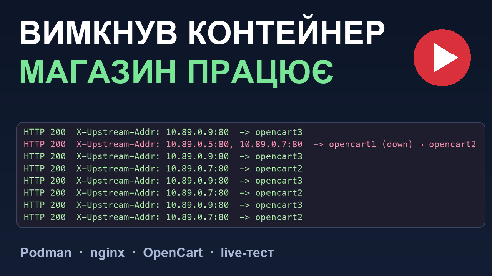
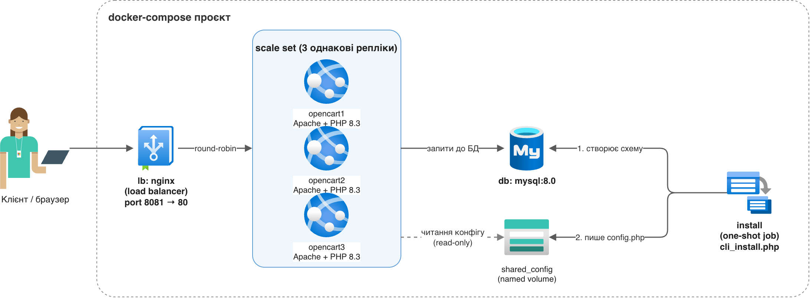

# LAMP + OpenCart

Повноцінний стенд **LAMP (Linux, Apache, MySQL, PHP) + OpenCart**, піднятий у двох незалежних
варіантах: усе в одному контейнері та через `docker-compose` з горизонтальним масштабуванням і
балансуванням навантаження. Виконано через **Podman** (`podman machine`, `podman-compose`) — без
Docker Desktop; команди `podman`/`podman-compose` сумісні з `docker`/`docker-compose` один в один.

[](https://youtu.be/qavPfMIcBoo)

▶ **Відео-розбір цього проєкту** (9 хв, українською, є англійські субтитри): структура, збірка,
розгортання, live-тест відмови реплік і слабке місце з базою даних.

OpenCart зібрано "з нуля" з офіційного релізу
[`opencart-4.1.0.4.zip`](https://github.com/opencart/opencart/releases/download/4.1.0.4/opencart-4.1.0.4.zip)
(а не з готового образу), з установкою через офіційний `install/cli_install.php` — так само, як
це робить головний `Dockerfile`/`docker-compose.yml` самого проєкту OpenCart.

## Архітектура (docker-compose варіант)



- **`lb`** (nginx) — єдина зовнішня точка входу, round-robin між трьома репліками застосунку.
- **`scale set`** — три однакові stateless репліки (`opencart1/2/3`), один і той самий образ,
  горизонтальне масштабування + відмовостійкість (якщо одна репліка падає, nginx перенаправляє
  трафік на живі без переривання обслуговування).
- **`install`** — one-shot job: один раз ставить схему БД (`cli_install.php`) і публікує готові
  `config.php`/`admin/config.php` у спільний volume, перш ніж стартують репліки.
- **`db`** (MySQL 8.0) — єдине спільне джерело істини для всіх реплік.
- **`shared_config`** — named volume зі згенерованим конфігом, репліки монтують його read-only.

Той самий стек також є у форматі Mermaid (`diagram.md`, рендериться прямо на GitHub) та у
форматі draw.io (`diagram.drawio` — відкривається на [app.diagrams.net](https://app.diagrams.net)
або в розширенні draw.io для VS Code; `diagram-azure.png` вище — його експорт).

## 1. `single-container/` — усе в одному контейнері

Відповідає літеральній послідовності завдання: MySQL + Apache + PHP + OpenCart в одному
Docker-образі.

- `single-container/Dockerfile` — Ubuntu 22.04 + `apache2`, `php` з розширеннями, `mysql-server`.
- `single-container/entrypoint.sh` — при старті контейнера:
  1. стартує `mysql`;
  2. створює БД `opencart`, користувача `opencart_user`, видає права (`GRANT ALL PRIVILEGES`);
  3. один раз запускає `install/cli_install.php` (створює схему + `config.php`) та реєструє
     українську мову;
  4. видаляє `install/`, запускає Apache на передньому плані.

```sh
cd single-container
podman build -t lamp-opencart-single .
podman run --rm -p 8082:80 --name lamp-single lamp-opencart-single
# http://localhost:8082/        -- вітрина
# http://localhost:8082/admin/  -- адмінка (admin / AdminPass123!)
```

Перевірено: `curl http://localhost:8082/` повертає `<title>Your Store</title>`, `/admin/` → `200`.

**Знайдена і виправлена проблема:** спершу вітрина падала з `Permission denied` при з'єднанні з
MySQL, хоча грант був коректний (`GRANT ALL PRIVILEGES ON opencart.* TO opencart_user@localhost`).
Причина — каталог `/var/run/mysqld` мав права `0700` (власник лише `mysql`), тому процес Apache
(`www-data`) не міг навіть зайти в директорію, щоб дістатися unix-сокета MySQL (сам файл сокета
був `0777`, але це не допомагало без прав на обхід каталогу). Виправлено додаванням
`chmod 755 /var/run/mysqld` в `entrypoint.sh` одразу після старту MySQL.

## 2. `compose/` — docker-compose, окремі контейнери, scale set, load balancer

```
compose/
├── docker-compose.yml
├── app/            # спільний образ Apache+PHP+OpenCart (без MySQL всередині)
│   ├── Dockerfile
│   ├── entrypoint.sh       # репліка: чекає конфіг з install job, копіює, запускає apache
│   ├── install-once.sh     # install job: один раз ставить схему БД + пише config.php
│   ├── install-ukrainian-language.php
│   └── lang/ukrainian.ocmod.zip
└── nginx/
    └── nginx.conf          # load balancer -> opencart1/2/3
```

Сервіси:

- `db` — `mysql:8.0`, окремий том `db_data`.
- `install` — one-shot job (`depends_on: db: condition: service_healthy`), ставить OpenCart
  через `cli_install.php`, реєструє українську мову, публікує готові
  `config.php`/`admin/config.php` у спільний volume `shared_config`, завершується (`restart: "no"`).
- `opencart1`, `opencart2`, `opencart3` — **scale set**: три однакові stateless репліки
  застосунку (одна й та сама збірка), кожна чекає завершення `install`
  (`condition: service_completed_successfully`), читає конфіг зі спільного volume (read-only).
- `lb` — `nginx:alpine`, round-robin балансування між трьома репліками, єдина зовнішня точка
  входу (`localhost:8081`).

```sh
cd compose
podman-compose up --build -d
curl -I http://localhost:8081/          # вітрина через LB
curl -I http://localhost:8081/admin/    # адмінка через LB
```

Перевірено: 6/6 запитів через LB повертають `200`, `install` завершився успішно
(`SUCCESS! OpenCart successfully installed on your server`), усі 3 репліки `opencart1-3`
у статусі `Up`.

Зупинити й прибрати стек:

```sh
podman-compose down        # зупинити й видалити контейнери + мережу
podman-compose down -v     # те саме + видалити db_data і shared_config (повний чистий старт)
```

## 3. Українська локалізація OpenCart (uk-ua)

Мовний пакет — [Ukrainian Localisation for OpenCart 4.0](https://opencartbot.com/en/ukrainian-opencart4)
(GPL v3, автор OpenCartBot, сумісний з 4.1.0.x). Файл `ukrainian.ocmod.zip` лежить у
`compose/app/lang/` та `single-container/lang/`.

Все інше — повністю автоматизовано, без жодного ручного кліку в адмінці:

- **`Dockerfile`** (обидва варіанти) при білді розпаковує `ukrainian.ocmod.zip` у
  `extension/ukrainian/` і копіює підпереклади для вбудованих модулів/способів оплати/доставки в
  `extension/opencart/` — тобто мова "вшита" прямо в образ, а не заливається через
  `Extensions → Installer` вручну. Для `compose/` це критично: мова одразу є в усіх 3 репліках,
  а не лише в тій, куди хтось один раз завантажив би файл через браузер.
- **`install-ukrainian-language.php`** — робить те саме, що відбувається при натисканні "Install"
  на мовному розширенні в адмінці, але напряму через SQL одразу після `cli_install.php`:
  реєструє `uk-ua` в `oc_language`/`oc_extension`, дублює дефолтні рядки (країни, зони, статуси
  замовлень/наявності, групи клієнтів, CMS-сторінки тощо) з `en-gb` на `uk-ua`, щоб вкладки
  "Українська" в адмінці не були порожні, додає SEO-keyword для перемикання мови на вітрині, і
  патчить `config_description`, щоб збереження `System → Settings → Store` не падало на
  порожньому полі Meta Title для нової мови.
- Викликається з `install-once.sh` (`compose/`) та `entrypoint.sh` (`single-container/`) одразу
  після `cli_install.php`, одноразово (ідемпотентно — перевіряє, чи `uk-ua` вже є в БД).

Мова додана як вибір (не примусовий дефолт), щоб не ламати решту демонстрації, яка орієнтована на
англійську. Перемкнути за замовчуванням: `System → Settings → Edit → Local → Language` в адмінці.

## 4. Демонстраційний товар

Щоб перевірити стек наскрізь, через адмінку OpenCart (`http://localhost:8081/admin/`, логін
`admin`/`AdminPass123!`) додано тестовий товар:

- **Назва:** Kyivstarlink — стартовий пакет
- **Модель:** `KYIVSTARLINK-01`
- **Ціна:** 100.00

Товар видно у списку адмінки та в публічному пошуку на вітрині, обслуженій через `lb` (тобто
запит пройшов через весь стек: nginx → одна з трьох реплік застосунку → MySQL). Видалити його
можна в адмінці: Каталог → Товари → галочка біля товару → Delete.

## Важливі облікові дані (лише для цього локального демо-стенду)

| Що | Значення |
|---|---|
| OpenCart admin | `admin` / `AdminPass123!` |
| MySQL root (compose) | `opencart_root_pw` |
| MySQL app-користувач (single-container) | `opencart_user` / `OpencartUserPw123!` |

## Відоме спрощення

Файлове сховище (`image/`, `system/storage/`) не розділяється між репліками `opencart1-3` —
кожна має свою локальну копію з образу. Для продакшну це потребувало б спільного/об'єктного
сховища; для демонстрації горизонтального масштабування з балансуванням навантаження це свідомо
спрощено (єдине спільне джерело істини — MySQL).

## Ліцензія

Проєкт поширюється за ліцензією **GNU GPL v3** (див. [`LICENSE`](LICENSE)), Copyright (C) 2026 Nimble85.

Сторонні компоненти:

- **OpenCart** (GPL v3) не входить до репозиторію: образи завантажують офіційний реліз під час збірки.
- **Українська локалізація** (`ukrainian.ocmod.zip`, автор [OpenCartBot](https://opencartbot.com/ukrainian-opencart4), на основі файлів мов OpenCart, GPL v3) поширюється в репозиторії без змін.
- **MySQL, PHP, Apache, nginx, Ubuntu** підтягуються як офіційні образи під час збірки й не розповсюджуються тут.
- **Іконки на діаграмі** взято з бібліотек draw.io (Azure icons, Microsoft). Вони використані лише для зображення архітектури і не означають схвалення з боку Microsoft.
