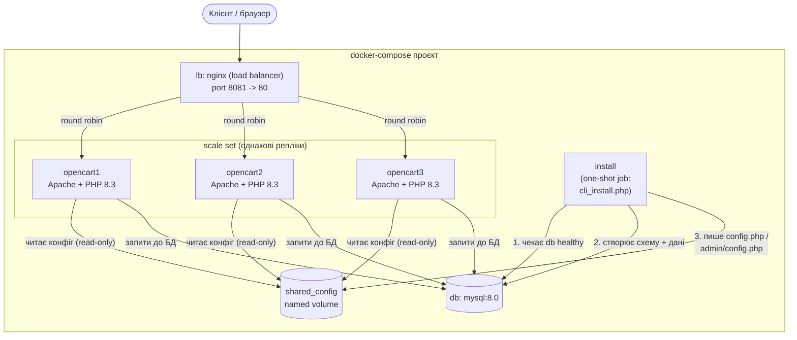

# Архітектура docker-compose версії (LAMP + OpenCart)

## Пояснення

- **Fault tolerance / scale set:** `opencart1`, `opencart2`, `opencart3` — три однакові, stateless
  репліки застосунку, зібрані з одного образу (`app/Dockerfile`). Будь-яка з них може впасти —
  `lb` продовжить обслуговувати трафік через решту.
- **Load balancer:** `nginx` (`nginx/nginx.conf`) приймає весь зовнішній трафік на порт 8081 і
  розподіляє запити між трьома репліками round-robin.
- **Одноразова ініціалізація:** сервіс `install` виконує `install/cli_install.php` рівно один раз
  (через `depends_on: condition: service_completed_successfully`), створюючи схему БД і
  `config.php`/`admin/config.php`, та публікує ці конфіги в спільний volume `shared_config`, який
  потім монтують (read-only) усі три репліки — так уникаємо гонки при одночасній установці з
  кількох контейнерів.
- **Стан:** єдине джерело істини — MySQL (`db`), том `db_data` для персистентності. Файловий стан
  (`image/`, `system/storage/`) у кожної репліки локальний і не розділяється — для продакшн-
  варіанту це потребувало б спільного/об'єктного сховища, але для демонстрації масштабування це
  свідомо спрощено.
